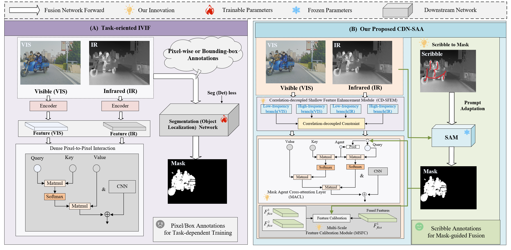

# CDN-SAA: CDN-SAA: Correlation Decoupling Network with Scribble-guided Agent Attention for Infrared and Visible Image Fusion
 Lei Maa,b, Liang Hu,b, Chengliang Jianga*,b, 

## 📌 Abstract 

> Infrared and visible image fusion (IVIF) aims to generate a more comprehensive scene representation
by combining the complementary characteristics of infrared and visible, which effectively addresses
the limitations of single-sensor perception in complex environments. However, existing image fusion
methods with semantic guidance still face three challenges: 1) they usually rely on task-specific
supervision or automatically generated semantic priors and lack a mechanism for users to explicitly
specify regions of interest, 2) cross-modal representations may not clearly distinguish modalityshared features from modality-specific detail features, which may hinder the subsequent interaction
of complementary information, and 3) semantic priors may be gradually diluted during long-range
cross-modal interaction and multi-scale feature propagation. To address these issues, we propose a
correlation decoupling network with scribble-guided agent attention for infrared and visible image
fusion. Specifically, we construct semantic masks using scribble prompts and exploit the powerful
zero-shot segmentation capability of SAM to guide cross-modal feature interaction in fusion, where
such masks intuitively embody human visual preferences. Subsequently, we propose a shallow feature
enhancement module with a novel correlation-decoupled constraint loss to improve shallow feature
representations and alleviate modal discrepancies by maximizing the correlation of low-frequency
features and minimizing the correlation of high-frequency features. In addition, we introduce a novel
masked agent cross-attention module to balance global semantic perception and local detail retention
by realizing effective interaction between agent features and semantic mask-guided key region
features, which can suppress the interference from misalignment artifacts and redundant background
information. Finally, we design a multi-scale feature calibration module to achieve mutual calibration
of cross-scale fused features under semantic mask guidance, so as to produce fusion images enriched
with abundant semantic information. Extensive experiments on several public benchmark datasets
demonstrate our model significantly improves the perceptual contrast and information richness of
fused images

## 🖼️ Network Architecture 
<p align="center">
  
</p>

<p align="center">
  
</p>
*Figure 2: Architecture of CDN-SAA*

---
Data Preparation

Download the M3FD dataset from this link and place it in the folder './MSRS_train/'.

CDDFuse Training

Run

python train.py
and the trained model is available in './models/'.

Testing

Run

python test.py

## 📊 Qualitative & Quantitative Results 

### 1. Visual Comparison 

<p align="center">
  
  
</p>
<p align="center"><em>Figure 2: Qualitative comparison on complex target-aware scenes.</em></p>

### 2. Quantitative Results 

| Dataset | Method | EN ↑ | SD ↑ | SF ↑ | AG ↑ | VIF ↑ | $Q_{abf}$ ↑ | AP@0.5 ↑ |
| :--- | :--- | :---: | :---: | :---: | :---: | :---: | :---: | :---: |
| **M3FD** | SeAFusion | 6.52 | 34.2 | 8.41 | 5.23 | 0.65 | 0.52 | 72.1% |
| **M3FD** | Target-aware | 6.70 | 36.1 | 8.85 | 5.50 | 0.68 | 0.55 | 74.5% |
| **M3FD** | **Ours (CDN-SAA)** | **6.89** | **38.5** | **9.21** | **5.92** | **0.73** | **0.61** | **78.3%** |
| **RoadScene** | **Ours (CDN-SAA)** | **6.75** | **37.2** | **8.95** | **5.70** | **0.71** | **0.59** | - |

---

### Prerequisites
- Python 3.8+
- PyTorch 1.12+ (CUDA 11.6+)
- NVIDIA GPU (Tested on RTX A6000 / RTX 4050)

### Installation
```bash

git clone [https://github.com/jiangchengliang59-code/CDN-SAA.git](https://github.com/jiangchengliang59-code/CDN-SAA.git)
cd CDN-SAA

conda create -n cdnsaa python=3.8 -y
conda activate cdnsaa

