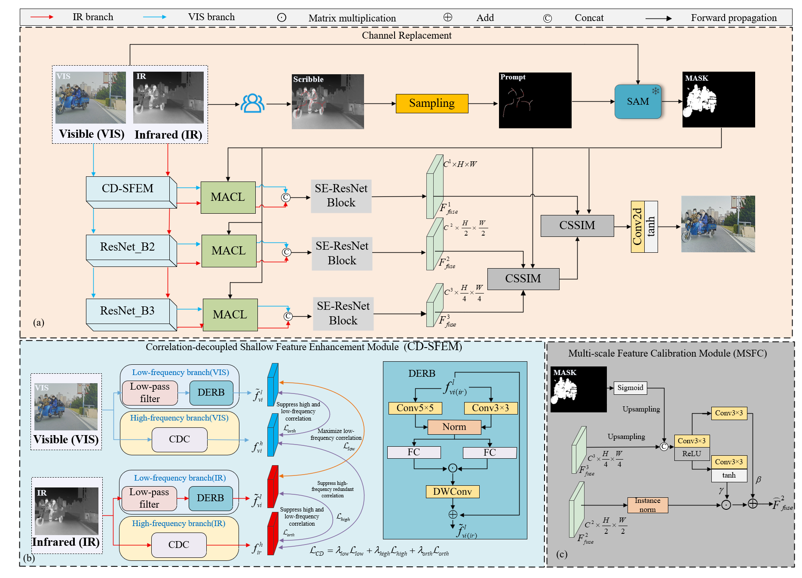
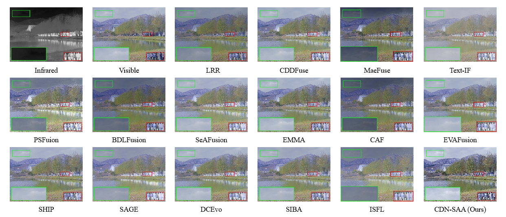
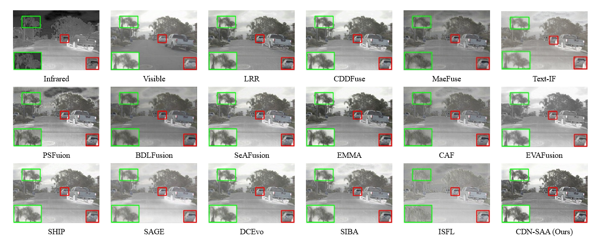
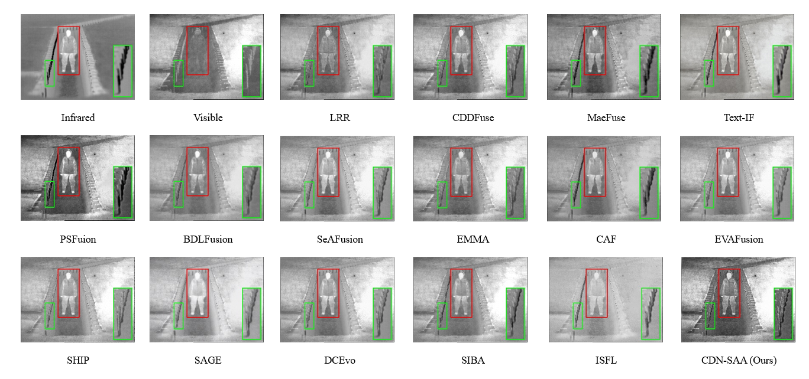

# CDN-SAA: CDN-SAA: Correlation Decoupling Network with Scribble-guided Agent Attention for Infrared and Visible Image Fusion
 Lei Maa,b, Liang Hu,b, Chengliang Jiang*,b, 

## 📌 Abstract 

> Infrared and visible image fusion (IVIF) aims to generate a more comprehensive scene representation by combining the complementary characteristics of infrared and visible, which effectively addresses the limitations of single-sensor perception in complex environments. However, existing image fusion methods with semantic guidance still face three challenges: 1) they usually rely on task-specific supervision or automatically generated semantic priors and lack a mechanism for users to explicitly specify regions of interest, 2) cross-modal representations may not clearly distinguish modalityshared features from modality-specific detail features, which may hinder the subsequent interaction of complementary information, and 3) semantic priors may be gradually diluted during long-range cross-modal interaction and multi-scale feature propagation. To address these issues, we propose a correlation decoupling network with scribble-guided agent attention for infrared and visible image fusion. Specifically, we construct semantic masks using scribble prompts and exploit the powerful zero-shot segmentation capability of SAM to guide cross-modal feature interaction in fusion, where such masks intuitively embody human visual preferences. Subsequently, we propose a shallow feature
enhancement module with a novel correlation-decoupled constraint loss to improve shallow feature representations and alleviate modal discrepancies by maximizing the correlation of low-frequency features and minimizing the correlation of high-frequency features. In addition, we introduce a novel masked agent cross-attention module to balance global semantic perception and local detail retention by realizing effective interaction between agent features and semantic mask-guided key region features, which can suppress the interference from misalignment artifacts and redundant background information. Finally, we design a multi-scale feature calibration module to achieve mutual calibration of cross-scale fused features under semantic mask guidance, so as to produce fusion images enriched with abundant semantic information. Extensive experiments on several public benchmark datasets demonstrate our model significantly improves the perceptual contrast and information richness of fused images.

## 🖼️ Network Architecture

<p align="center">
  
</p>

*Figure 1: Comparison between conventional task-oriented IVIF methods and the proposed CDN-SAA.*

<p align="center">
  
</p>

*Figure 2: Overview of the CDN-SAA architecture for interactive infrared and visible image fusion.*

---

## 🚀 How to Run

### 1. Prerequisites

- Python 3.8+
- PyTorch 1.12+
- A compatible NVIDIA GPU and CUDA environment

### 2. Installation

```bash
git clone https://github.com/jiangchengliang59-code/CDN-SAA.git
cd CDN-SAA

conda create -n cdnsaa python=3.8 -y
conda activate cdnsaa
```

### 3. Data Preparation

Organize the datasets as follows:

```text
datasets/
├── M3FD/
│   ├── ir/
│   └── vi/
├── RoadScene/
│   ├── ir/
│   └── vi/
└── TNO/
    ├── ir/
    └── vi/
```

Before training or testing, configure the dataset paths, hyperparameters,
and model settings in `options/fusion.yml`.

<!-- Add the actual training and testing commands here. -->

---

## 📊 Qualitative and Quantitative Results

### 1. Visual Comparison

<p align="center">
  
</p>

*Figure 3: Qualitative fusion results for scene "01937" from M3FD.*

<p align="center">
  
</p>

*Figure 4: Qualitative fusion results for scene "FLIR_00977" from RoadScene.*

<p align="center">
  
</p>

*Figure 5: Qualitative fusion results for scene "03" from TNO.*

### 2. Quantitative Comparison

<!-- Upload the results image and replace this filename if necessary. -->

<p align="center">
  
</p>

*Table 1: Quantitative comparison on the evaluated datasets.*
